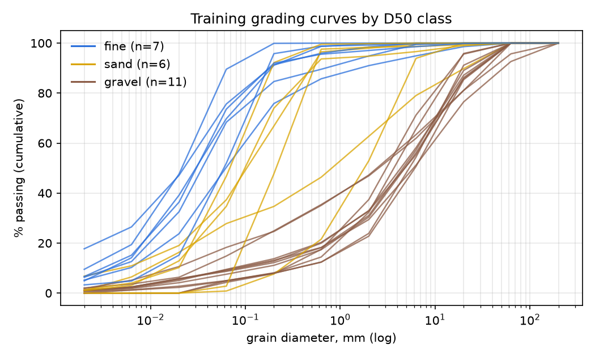
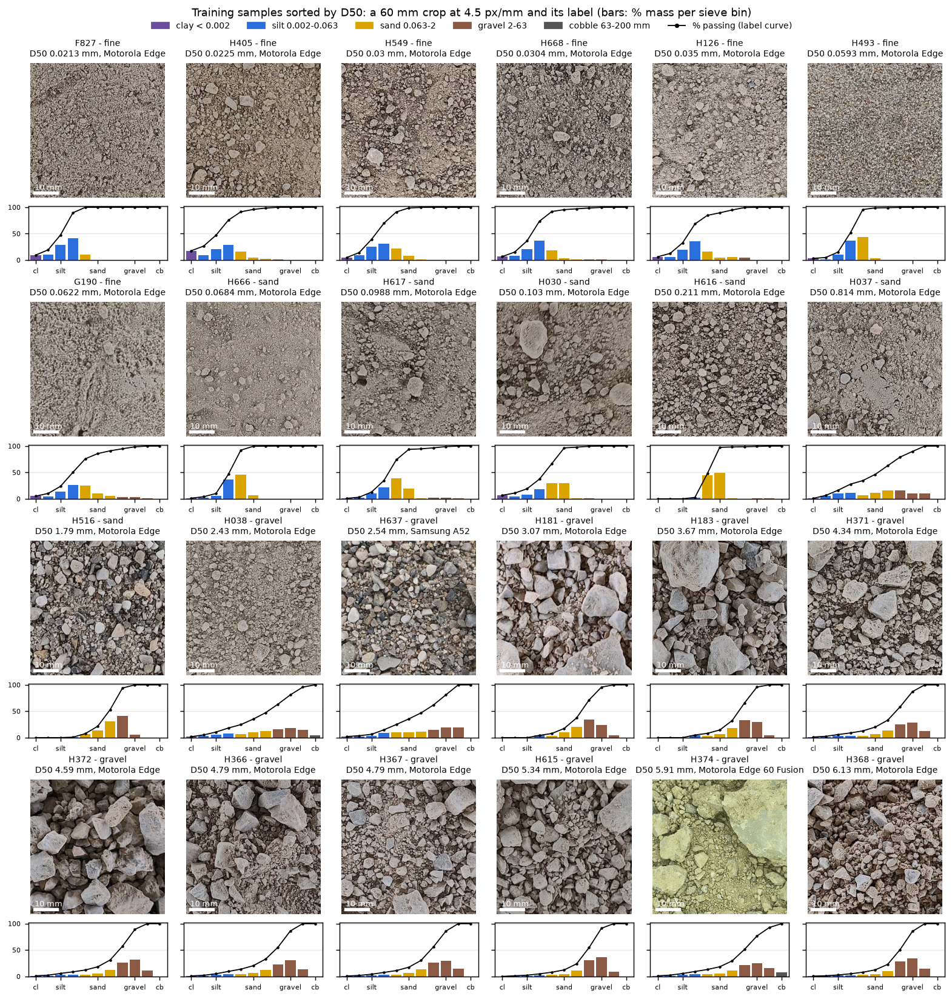
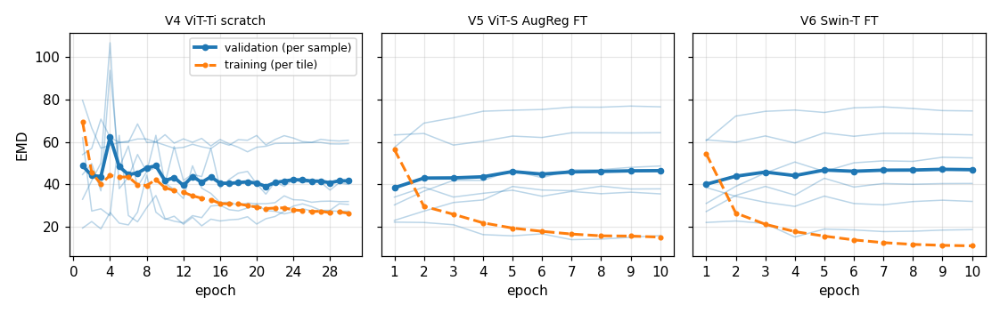
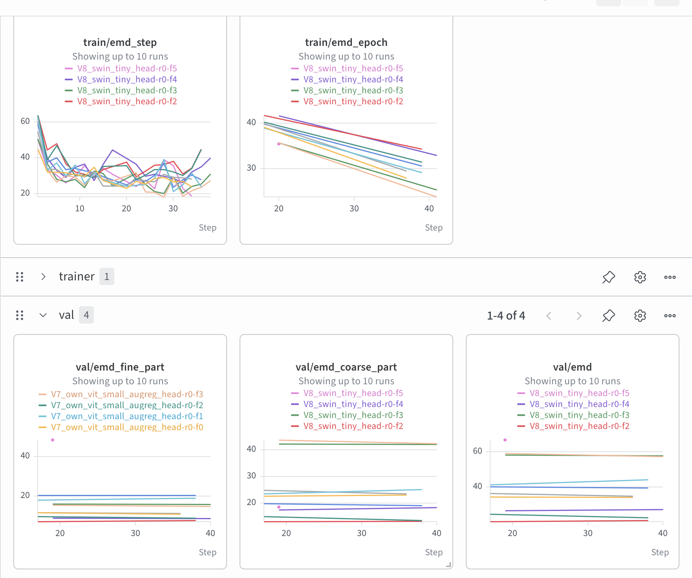
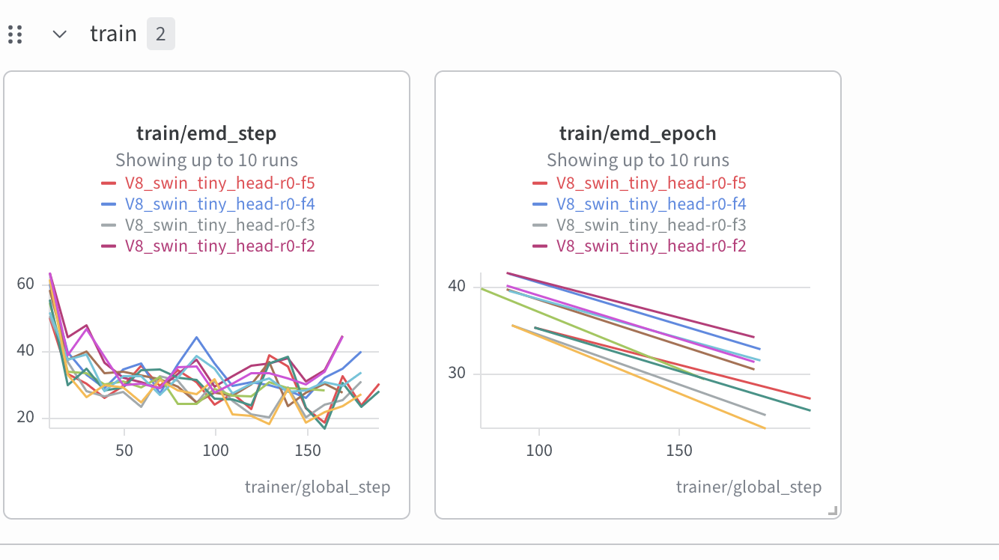
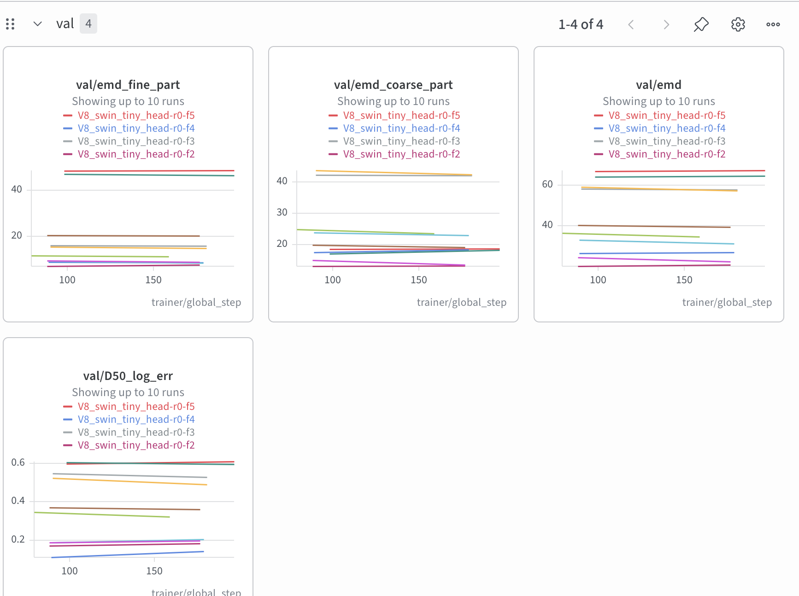
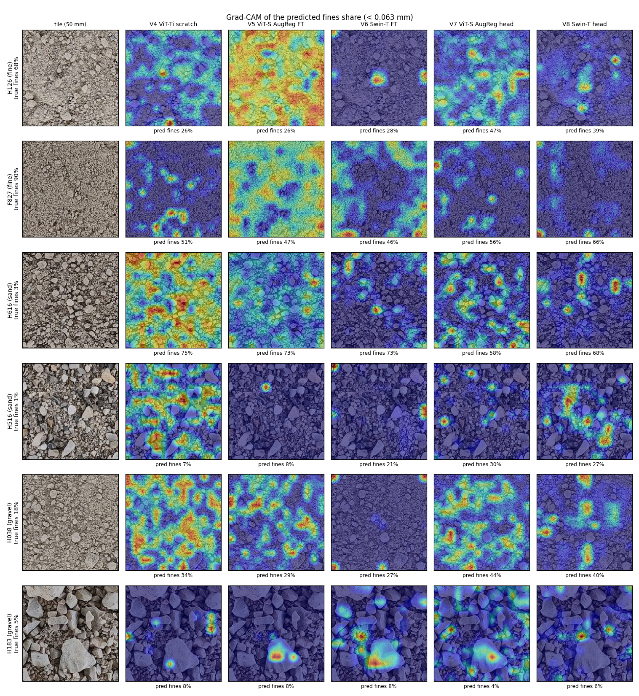
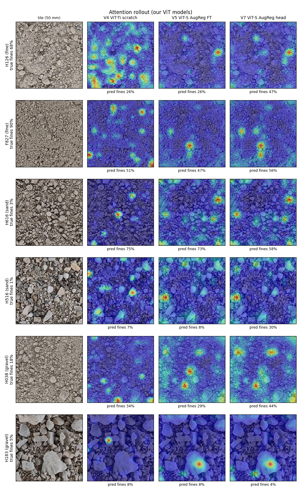

# Part 2 – Vision Transformers

Soil grain-size curves from smartphone photos with our own ViT (Lecture 1), a pretrained ViT-S and Swin-T,
each fine-tuned end to end and with a frozen backbone. Same tiles, folds, loss and metric as every other
experiment in the repository; code in [`part2_vit/`](../../part2_vit/).

**Main results**

- A **frozen pretrained backbone with only the head trained** is the best way to use a pretrained transformer
  here: Swin-T 38.5 and ViT-S 39.8 CV EMD, against 43.1–43.4 for the same models fine-tuned end to end. The
  public leaderboard moves the same way (65.6 / 72.4 against 79.2 / 81.1).
- **Our ViT-Ti trained from scratch (39.3)** matches the frozen pretrained models and beats the fine-tuned ones.
  Fine-tuning a pretrained transformer on 24 soils makes it memorise the training soils (training EMD keeps
  falling, validation EMD stops improving after the first epoch).
- Every model fails the same way: **fine soils and sand are confused in both directions**. Silt and clay are
  smaller than a pixel (0.22 mm), and oven-dried fine soils form sand-sized clumps.
- **Colour alone gets surprisingly far:** a model that sees only colour statistics, no grain shapes, scores 42.6,
  as good as the fine-tuned transformers; the best model adds about 4 EMD over it. Taking colour away from the
  trained models barely changes their fine-soil error, except for the scratch ViT-Ti (+7.5), which leans on
  colour for fine soils.
- All models clearly beat image-free baselines on the test photos (best 65.6 vs 102.4 for the mean curve), but
  keep only about two thirds of their CV advantage there.

Differences between the five models are about 4 EMD on one CV split, inside split noise (paired Wilcoxon
p ≥ 0.18). The frozen-vs-fine-tuned conclusion rests on CV and leaderboard agreeing for both architectures.

## 1. Data in brief (EDA)

Full tables: [`reports/eda/summary.md`](../eda/summary.md).

| | Train | Test |
|---|---|---|
| Soil samples / photos | 24 / 127 | 10 / 35 |
| Devices | Motorola Edge, Samsung A52 (+ 3 photos Motorola Edge 60 Fusion) | iPhone 14, iPhone 16 |
| Effective scale | **4.6 px/mm** (stored downscaled; `ppm_updated.csv` says 11.5 / 26.3) | 13.9 / 19.5 px/mm |
| D50 classes | 7 fine (< 0.063 mm), 6 sand, 11 gravel (> 2 mm) | unknown |

- **Scale.** Training photos are stored downscaled, so their real scale is about 4.6 px/mm. A pipeline that
  trusts the listed px/mm sees test grains 3–4× too large, and a 2× scale error alone costs about 30 EMD.
  Every photo is therefore resampled to a common 4.5 px/mm before tiling.
- **Resolution limit.** One pixel is 0.22 mm, so silt and clay (< 0.063 mm) are never resolved as grains; the
  median soil has 16.5 % of its mass there (range 0.8–89.6 %).
- **Devices are not a shortcut inside the training set**: 21 of 24 soils were photographed with both the
  Motorola and the Samsung. Device does matter for the test set: training photos are brown and the Motorola
  ones look strongly sharpened, while test photos are neutral grey ([scale sheet](../eda/scale_sheet.png)).
- **Image-free references** (same folds): uniform curve 102.0, mean training curve 89.5, an oracle that only
  knows the D50 class 29.7. Getting the soil class right is most of the score.





## 2. Setup shared by all Part 2 models

| | |
|---|---|
| Input | 50 mm tiles of the soil region at 4.5 px/mm (225 px → 224): 21–35 tiles per photo, 3,458 tiles from 127 photos, but only 24 distinct labels (every tile carries its soil's curve) |
| Validation | 6-fold group CV from `data/folds.csv`, repeat 0: a soil's photos and its near-duplicate "family" never split; same folds as Parts 0–3 |
| Output head | 11 logits → softmax (mass share per sieve bin) → cumulative sum = valid curve by construction; bias initialised to the log of the mean training shares, so training starts from the mean curve |
| Loss | the competition EMD itself (log-width-weighted L1 between curves) |
| Sampling | every training soil drawn equally often, whatever its number of tiles |
| Prediction | each tile with its 8 rotations / flips averaged → mean over tiles → photo → sample |
| Optimiser | AdamW, linear warmup + cosine; no weight decay on biases, norms, position embeddings, [CLS] |
| Compute | Kaggle Tesla T4, fp16 mixed precision |
| Submission | mean test curve of the 6 fold models |

Augmentations keep millimetres per pixel: rotations by 90° and flips, plus mild brightness / contrast (±10 %)
for the fine-tuned models; rotations and flips only for the frozen ones. Zoom, random resized crops and blur
change the apparent grain size and are left out.

### Why tiles of 50 mm at 4.5 px/mm

The tiling comes from Part 0 and is kept unchanged so that CNN, ViT and SSL results stay comparable.

```
photo (12–48 MP) → soil region → resampled to 4.5 px/mm → 50 mm squares (225 px → 224) → ViT patches of 16 px
                                                                                         (3.6 mm, 196 per tile)
```

- **One scale for every phone.** Grain size is a physical length, so the network must see the same millimetres
  per pixel on every device. Without resampling, test grains look 3–4× larger, and a 2× scale error alone costs
  about 30 EMD.
- **4.5 px/mm is the real resolution of the training photos.** They are stored downscaled to about 4.6 px/mm;
  a finer scale would only upsample. Halving it to 2.25 px/mm gave the same score (block T, T3).
- **Tiles instead of the whole photo.** A whole photo squeezed into 224 px is about 1.4 mm per pixel, and all
  sand disappears. At full resolution a ViT would need tens of thousands of tokens, and attention cost grows with
  their square. A 50 mm tile is 196 tokens, and a photo gives 21–35 tiles whose predictions are averaged.
- **50 mm** holds most gravel grains (2–63 mm) and still gives many tiles per photo. 20 mm tiles scored the same
  overall: slightly better on the fine part of the curve, worse on the coarse part (block T, T2).
- **224 px with 16 px patches** is the input the pretrained ViTs were trained on, so their weights and position
  embeddings are used as they are. The cost is that a 3.6 mm patch is larger than a sand grain, so the model
  sees sand only as texture inside a patch.

### How tiles get labels, and a better loss to try next

There is one sieve analysis per soil, so **every tile carries its soil's whole curve, unchanged**. Rotations,
flips and mild colour changes do not change grain size and keep the label; only CutMix (not used in these
runs) mixes the curves of two soils by area. Scores are computed after averaging the tiles back to one curve
per soil, which is exactly the competition's unit.

The weakness: a soil is not uniform in the tray. A tile with one large stone and a tile of fine matrix get the
same target, so most individual tile targets are wrong and only their average is right. The per-tile EMD loss
pushes every tile towards a "typical" answer for its soil. The label actually describes the *mixture* of all
the soil in the photo, which suggests a bag-level (multiple-instance) loss:

```
now:  loss = mean over tiles of EMD(tile prediction, soil curve)
next: loss = EMD(mean of the tile predictions of one photo or soil, soil curve)
```

With it, a stone tile may predict gravel and a matrix tile fines, as long as their average matches the sieve
result. The same idea one level down is a per-patch head whose bin shares are averaged over the 196 patches:
the patch shares then act as a size-class map learned without masks, and their mean is an area fraction, which
approximates the mass fraction (Delesse's principle). Both need batches that group the tiles of one photo, and
neither has been run yet.

## 3. Models

| | Backbone | Init | Trained | Epochs | lr | Layer decay |
|---|---|---|---|---|---|---|
| V4 | our ViT-Ti/16 (192-d, 12 blocks, 3 heads, mean pooling) | random | everything | 30 | 5e-4, warmup 3 | – |
| V5 | our ViT-S/16 (384-d, 12 blocks, 6 heads, [CLS]) | AugReg ImageNet-21k (`vit_small_patch16_224.augreg_in21k_ft_in1k`) | everything | 10 | 1e-4, warmup 1 | 0.75 |
| V6 | Swin-T (`swin_tiny_patch4_window7_224.ms_in22k_ft_in1k`) | ImageNet-22k | everything | 10 | 1e-4, warmup 1 | 0.75 |
| V7 | as V5 | AugReg | head only | 2 | 1e-3 | – |
| V8 | as V6 | ImageNet-22k | head only | 2 | 1e-3 | – |

V4 and V5 use the same class ([`part2_vit/vit.py`](../../part2_vit/vit.py), the Lecture 1 implementation) and
differ only in size and initialisation; the AugReg weights load into it unchanged.

## 4. Results

CV on one split (6 folds, 24 soils); public LB = 3 of the 10 test soils.

| Model | CV EMD | ± folds | Fine | Sand | Gravel | EMD < 0.2 mm | EMD > 0.2 mm | Public LB |
|---|---|---|---|---|---|---|---|---|
| V4 ViT-Ti scratch | 39.3 | 13.5 | 45.0 | 53.5 | 27.9 | 15.6 | 23.7 | 85.7 |
| V5 ViT-S AugReg, fine-tuned | 43.1 | 19.8 | 61.0 | 55.2 | 25.1 | 17.3 | 25.8 | 79.2 |
| V6 Swin-T, fine-tuned | 43.4 | 18.8 | 63.4 | 53.9 | 25.0 | 17.7 | 25.8 | 81.1 |
| **V7 ViT-S AugReg, head only** | 39.8 | 14.8 | 46.1 | 46.1 | 32.3 | 15.1 | 24.6 | **65.6** |
| **V8 Swin-T, head only** | **38.5** | 16.4 | 46.1 | 49.8 | 27.4 | 15.6 | 22.9 | 72.4 |
| X1 colour statistics only + ridge (control, 5.2) | 42.6 | 14.5 | 55.5 | 47.6 | 31.7 | 14.3 | 28.4 | – |
| B0 mean training curve (no photo) | 90.2 | | 108.5 | 69.5 | 88.3 | | | 102.4 |
| B1 median training curve | 98.6 | | 128.9 | 81.6 | 81.8 | | | 90.3 |
| B2 random training curve | 103.1 | | 125.0 | 100.1 | 114.0 | | | – |

Fine / sand / gravel: mean EMD over soils of that D50 class. Baseline class columns are averaged over all 3
CV repeats.

± folds: standard deviation of the 6 fold means.

**Paired comparison per soil** (Wilcoxon signed-rank, 24 soils):

| | Mean difference | p |
|---|---|---|
| V4 − V5 | −3.8 (V4 better on 15 of 24) | 0.24 |
| V4 − V6 | −4.1 | 0.30 |
| V5 − V6 | −0.3 | 0.60 |
| V4 − frozen MAE / DeiT-S scratch / ResNet-18 SGD | +2.7 to +4.0 | 0.18–0.32 |

None of these is significant on one split. Repeats 1–2 of the folds are the next step for the close pairs.

## 5. Analysis

### 5.1 Fine-tuning a pretrained transformer makes it memorise

*Models trained end to end (V4–V6): validation EMD per fold (thin), its mean (thick) and training EMD (dashed).*



*Head-only models (V7, V8), from W&B: training EMD per step and per epoch, validation EMD per fold.*







Training EMD is per tile and validation EMD per soil (after averaging tiles), so the two levels are not directly
comparable; what matters is how each moves.

| | Full fine-tuning (V5 ViT-S, V6 Swin-T) | Scratch (V4 ViT-Ti) | Head only (V7, V8) |
|---|---|---|---|
| Training EMD | falls from about 55 to 11–15 over 10 epochs | falls slowly, about 70 → 26 over 30 epochs | falls from about 60 to about 30 within the first ~30 steps, then only fluctuates (20–40) |
| Mean validation EMD | **best after epoch 1** (about 38–40), then rises to about 46–47 and stays | noisy for ~10 epochs (a spike right after warmup ends), then flat around 41 | flat from the first measurement (changes of 1–2 EMD per fold) |
| Per fold | V6 rises in folds 1 (30 → 52), 4 (27 → 40) and 5 (57 → 75) | – | no fold drifts |

**Full fine-tuning memorises.** With about 20 training soils per fold, a pretrained network can lower its
training loss by recognising *which soil* a tile comes from, and with all its weights free it does: training EMD
keeps falling while validation gets worse. Whatever it learned about grain size is learned in the first epoch;
the later epochs fit the training soils. Stopped after one epoch, V5 and V6 would have been at about 38–40, the
level of the head-only models. That number is read off the validation curves, so it is a hint, not a result:
choosing the epoch on these folds and reporting CV on the same folds would be optimistic.

**The scratch ViT-Ti cannot memorise as easily.** It is small (5.7M parameters) and starts from nothing, so its
training EMD falls slowly and stays far from the fine-tuned models' 11–15. Its validation settles around 41
after a noisy start (the spike comes right after warmup, at the peak learning rate).

**Head only cannot memorise, and converges almost at once.** The backbone is fixed, so the only thing that adapts
is a linear map from the backbone's features (768 for Swin-T, 384 for ViT-S) to 11 bin shares. It finds its best fit within a third of an epoch, and
validation does not drift afterwards. This is why the head-only models are 3–5 EMD better in CV and 9–14 better
on the leaderboard, almost entirely on fine soils (61–63 → 46). The cost is gravel (V7: 32.3 against 25.1),
where fine-tuned features describe large stones better.

**The hard folds are hard from the first measurement.** In the head-only runs the two worst folds sit at about
57–67 EMD (about 47 on the part of the curve below 0.2 mm) from epoch 1 and do not move. A longer or differently
tuned head cannot fix them: the frozen features do not separate those soils (fine soils that look sandy and the
other way round, see 5.2). Improving them needs better features or better use of the labels (section 2, next
steps in the loss), not more training. Since the head is linear and converges this fast, a closed-form ridge on
the same frozen features would do the same job, which is what Part 3 does for the self-supervised encoders.


### 5.2 Is the model reading colour? Control experiment

**The suspicion.** Silt and clay are smaller than a pixel, so on a fine soil the model cannot see grains. It
could still get the fine part of the curve "right" from colour: the soils from one site share a colour, and soils
from the same site have similar curves. That would be a shortcut: it works inside the training set but breaks
on soils from new sites, such as the test set, whose iPhone photos are also a different colour (grey instead of
brown). Every model confuses fine soils with sand, so the question is whether colour is behind it.

**The test.** A shortcut can be checked in two directions:

| Question | Test |
|---|---|
| Does the model *need* colour? | Take colour away from the input of the trained models and see how much worse they get |
| Is colour *enough*? | Train a model that sees *only* colour and see how good it gets |

**Test 1: take colour away.** Each fold model predicted the soils it never saw twice: once as photographed,
once with colour removed. "Removed" means every tile's per-channel mean and standard deviation are set to the
average of the training tiles. Grain shapes, edges and texture stay; colour cast, brightness and contrast go.
Script: [`part2_vit/colour_test.py`](../../part2_vit/colour_test.py). If a model relies on colour, its error
rises sharply without it, most of all on fine soils.

| Model | EMD as photographed | EMD without colour | Change | Fine soils | Sand | Gravel | Mean predicted fines % |
|---|---|---|---|---|---|---|---|
| V4 ViT-Ti scratch | 39.3 | 41.1 | +1.8 | **+7.5** | −6.4 | +2.7 | 28.4 → 24.5 |
| V5 ViT-S fine-tuned | 43.1 | 42.6 | −0.5 | +1.8 | −4.4 | +0.3 | 26.1 → 26.9 |
| V6 Swin-T fine-tuned | 43.4 | 41.8 | −1.6 | −1.2 | −6.3 | +0.7 | 26.5 → 28.4 |
| V7 ViT-S head only | 39.8 | 42.3 | +2.5 | +4.2 | −0.2 | +2.9 | 28.6 → 30.3 |
| V8 Swin-T head only | 38.5 | 43.6 | +5.1 | +1.4 | +2.1 | +9.2 | 28.5 → 30.3 |

**Test 2: colour only.** A ridge regression on colour statistics of each tile, with no spatial information at
all: per-channel mean, standard deviation and an 8-bin histogram, plus mean and standard deviation of
brightness. All of these stay the same if the pixels of a tile are shuffled, so the model sees no grain shapes or
sizes. Same tiles, folds and averaging as every other model
([`X1_colour_only.yaml`](../../part2_vit/configs/X1_colour_only.yaml)).

| Same split (repeat 0) | CV EMD | Fine soils | Sand | Gravel |
|---|---|---|---|---|
| Colour statistics only (X1) | 42.6 | 55.5 | 47.6 | 31.7 |
| Best transformer (V8 head only) | 38.5 | 46.1 | 49.8 | 27.4 |
| Fine-tuned transformers (V5, V6) | 43.1–43.4 | 61.0–63.4 | 53.9–55.2 | 25.0–25.1 |
| Mean training curve, no photo (B0) | 90.2 | 108.5 | 69.5 | 88.3 |

**What it shows.**

- **Colour carries most of the signal the models use.** Colour and brightness statistics alone get from 90.2
  (no photo) to 42.6, and the best transformer adds only about 4 EMD on top of that. The fully fine-tuned ViT-S
  and Swin-T do *not* beat the colour-only model at all (43.1 and 43.4).
- **The scratch ViT-Ti leans on colour for fine soils.** Without colour its fine-soil error rises by 7.5 EMD and it
  predicts 4 percentage points less fines. Part of its advantage on fine soils (45.0, the best of all models)
  comes from colour, which is exactly the cue at risk on the grey iPhone test photos.
- **The other models do not need colour.** Their fine-soil error changes by −1.2 to +4.2. So the fine ↔ sand
  confusion is not caused by colour: it happens with and without it.
- **Colour misleads the end-to-end models on sand.** V4, V5 and V6 all get *better* on sand without colour
  (−4.4 to −6.4 EMD), and the colour-only model is also better on sand (47.6) than they are (53.5–55.2).
  Training all weights taught them a colour cue that does not hold for sandy soils, which fits the memorisation
  seen in 5.1.
- **Gravel loses most for the head-only Swin (+9.2).** The normalisation also equalises each tile's contrast, and a
  stone against a fine matrix is largely a brightness-contrast cue, so this is a loss of contrast more than of
  colour.

**In short:** colour is a strong signal in this data set, strong enough that a pixel-shuffle-invariant colour
model matches the fine-tuned transformers. The useful extra that the image models add over colour is modest
(about 4 EMD), and most models do not depend on colour, but the scratch ViT-Ti does on fine soils.

**Limits.** One CV split, so changes under about 5 EMD are close to noise. The normalisation removes contrast
together with colour; a grey-scale variant (`--mode gray`) would keep contrast and separate the two.


### 5.3 Attention and Grad-CAM maps

Each row is one soil, the same 50 mm tile for every model, and each model is the fold model that never saw that
soil. Under each map: the model's predicted fines share for that tile; on the left: the true value. Rows H126,
F827 (fine) and H616 (sand) are failure cases, H516 (sand) and H183 (gravel) are predicted well, H038 (gravel,
looks fine) is in between. Maps are normalised per tile, so their colour shows *where* the evidence is within a
tile, not how strong it is compared with another tile.

**Grad-CAM of the predicted fines share** (the share below 0.063 mm), the same method for all five models. For
our ViTs it is taken at the input of the last block: with [CLS] pooling, patch tokens after the last block never
reach the head, so their gradient is zero.



- **All five models fail the same soils the same way.** H616 is sand with 3 % fines and every model predicts
  58–75 % fines. H126 (68 % fines) and F827 (90 %) are predicted far too coarse. The gravel soil H183 is right
  for every model (4–8 % against 5 %). A shared failure across a scratch ViT, a pretrained ViT and Swin, fine-tuned
  or frozen, points to the photos, not to an architecture: H616 is a field of small rounded grains that looks
  like dried fine soil, and H126 is a fine soil full of sand-sized clumps.
- **The plain ViTs spread their fines evidence over large parts of the tile** (V4 on H616 and H038, V5 on H126
  and F827, V7 on H126 and H038). They read fines as a property of the texture everywhere, a statistic rather than
  a location. The Swin models put it on a few local spots, which matches their local windows and 14 × 14 stage-3
  grid.
- **On the gravel tile, most of the evidence sits in the gaps between stones**, where the fine matrix is. The
  ViT-S models and the fine-tuned Swin also mark the large stone. For the ViT-S models that is the same token the
  rollout highlights (below), so it is more likely an attention sink than real evidence of fines.

**Attention rollout** of our three ViTs (Swin has no global attention to roll out).



- **Fine-tuning barely changes where the ViT-S attends.** The fine-tuned V5 and the frozen V7 have almost
  identical rollout maps on every soil, yet they score 43.1 and 39.8. The difference between them comes from the
  features and the head, not from the attention pattern.
- **Attention concentrates on a few isolated tokens:** single grains or the face of the large stone in H183.
  These are typical attention sinks (Darcet et al., 2024). Rollout shows where information is routed, not what
  decides the curve.
- **The scratch ViT-Ti spreads its attention more,** most visibly on the fine soil H126, where it scores best of
  all models (fine soils 45.0 against 61–63 for the fine-tuned ones).

**Rollout or Grad-CAM?** Rollout is the same map whatever the model predicts; Grad-CAM is tied to one output,
here the fines share. To ask "what in the image makes this model predict fines?", Grad-CAM is the one to read.
Neither proves a shortcut on its own; that needs a control with a number, such as the colour test in 5.2.


## 6. CNN vs ViT optimisation

| | What worked | What did not |
|---|---|---|
| CNN (Part 1) | ResNet-18 with SGD + momentum at lr 1e-4 and frozen BatchNorm statistics (39.6, 3 repeats) | larger SGD lr (1e-3: 47.8; 1e-2 diverged), ConvNeXt-T fine-tuned (47.0) |
| ViT (Part 2) | frozen pretrained backbone + head (38.5–39.8); small ViT from scratch with AdamW, warmup and 30 epochs (39.3) | fine-tuning ViT-S / Swin-T end to end (43.1–43.4) |

The common thread is that *gentle* adaptation of pretrained weights works and aggressive adaptation does not.
The recipes differ because of inductive bias. A CNN already has locality and translation equivariance built in,
and pretrained convolutions transfer to texture with small, plain SGD steps. A ViT has neither, so it needs
AdamW, warmup and stochastic depth to train from scratch at all, and its pretrained attention patterns are tied
to objects. They are worth keeping frozen on a texture task with 24 samples rather than re-learned.
